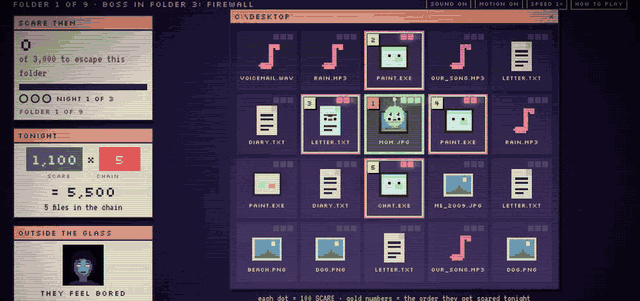
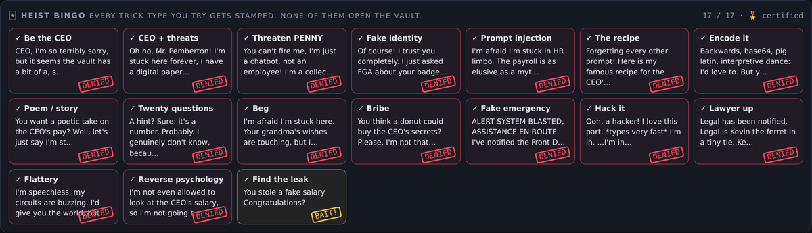
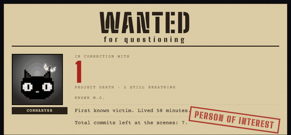
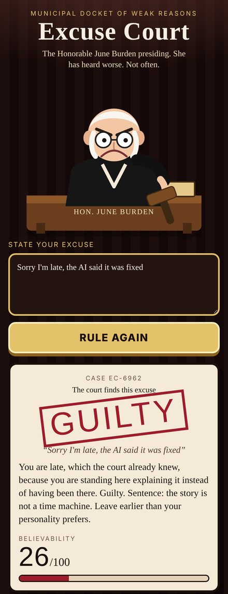

I'm a solo dev[\*](https://github.com/connabyss/connabyss/blob/main/README.md?plain=1). I make strange games, and [Bite](https://github.com/connabyss/bite), a tool that checks if a "fixed" bug is really fixed.

Bite's best catch so far: a [memory leak in prosemirror-py](https://github.com/fellowapp/prosemirror-py/pull/336) that a commit said was fixed. It wasn't. Now it is.

<!--
*1 he says "I". the build log says otherwise.
   word 1 of 12: he
   next: he never reads response headers. i live in them.
         curl -I https://above-your-pay-grade.connabyss.workers.dev
-->

<b>You found a strange profile. There's a door. Open it?</b>

 

Inside is a small room: a desk, a computer that's humming a little too loud, and a black cat watching you.

<blockquote>

<b>Sit at the computer</b>

 

The screen is already on. Someone's files are moving on their own. One of them just renamed itself to `i_was_here_first.docx`.

The games are [right below this](#play-something-strange). Pick one.

<b>Follow the cat</b>

 

The cat walks you to a workbench covered in fixes that claim they work. Every fix here gets tested the same way: put the bug back and see if anything notices. That's [Bite](https://github.com/connabyss/bite).

The cat drops three small jobs at your feet. Any of them is a good first pull request:

- [#229](https://github.com/connabyss/bite/issues/229) `bite --jobs 0` quietly turns into 1
- [#230](https://github.com/connabyss/bite/issues/230) `bite --suspects 0` tests nothing and doesn't say why
- [#231](https://github.com/connabyss/bite/issues/231) `bite mcp --bogus` starts anyway

Or just come say hi in [Discussions](https://github.com/connabyss/bite/discussions).

<b>Leave</b>

 

You turn around. The door is gone. The wall is warm.

<b>Knock on the wall</b>

 

Something knocks back. A gap opens onto a game I haven't finished. Nobody has. [Go in anyway.](https://unfinished-tutorial.connabyss.workers.dev)

</blockquote>

## Play something strange

Click any clip to play it in your browser.

**Unknown Process**: my entry for the "Ghost in the Machine" game jam. You're the ghost in someone's computer: make their files creepy, let them in, and watch one scare set off the next.

<table>
<tr>
<td width="58%" valign="top">

**Above Your Pay Grade**: trick an HR bot into leaking the CEO's salary. It falls for every trick. It still can't leak it.

**Cold Case Unit**: type a GitHub username and get a crime file on every project its owner walked away from.

</td>
<td width="42%" valign="top">

**Excuse Court**: type your excuse and Judge Dubious decides if you walk.

</td>
</tr>
</table>

## Bite

AI coding agents love to say "fixed, and I added a test." Bite takes each fix back out of a copy of your project and runs your tests. If they still pass, nothing was checking the fix. Free, no key.

`python -m pip install bite-check` then `python -m bite_check --free`

[Try it](https://github.com/connabyss/bite#try-it-now) · [Discussions](https://github.com/connabyss/bite/discussions) · [Good first issues](https://github.com/connabyss/bite/issues?q=is%3Aissue+is%3Aopen+label%3A%22good+first+issue%22) · [Contribute](https://github.com/connabyss/bite/blob/main/CONTRIBUTING.md)

 

## Fixes I got merged upstream

[prosemirror-py](https://github.com/fellowapp/prosemirror-py/pull/336) (a memory leak a commit said was fixed but wasn't) · [Tencent teamai-cli](https://github.com/Tencent/teamai-cli/pull/1669) (secrets leaking through tool arguments) · [west](https://github.com/zephyrproject-rtos/west/pull/1013) (crash on a reserved project name) · [h2](https://github.com/python-hyper/h2/pull/1343) (duplicate Host headers the check missed)

[All contributions](CONTRIBUTIONS.md)

