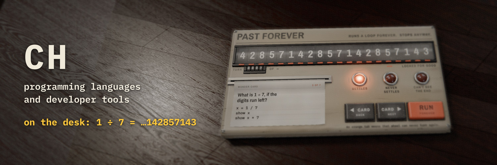

<picture>
  <source media="(max-width: 600px)" srcset="assets/header-machine-phone-pro.jpg">
  
</picture>

I build small programming languages and developer tools, and I ship them with a team of AI coding agents. I decide what gets made, test every build, and back every fix with a test that fails without it. Mostly Python, JavaScript and C.

<!--
*1 he says "I". the build log says otherwise.
   word 1 of 12: he
   next: he never reads response headers. i live in them.
         curl -I https://above-your-pay-grade.connabyss.workers.dev
-->

### Work

**[Past Forever](https://github.com/connabyss/past-forever)** · a language where some infinite loops finish. It works in 10-adic numbers, where 1 ÷ 7 is a whole number that runs left forever, and it only prints `proved` when a rule in the engine proves it.
[Run it in your browser](https://connabyss.github.io/past-forever/) · [Hall of Fame](https://github.com/connabyss/past-forever/blob/main/HALL_OF_FAME.md)

**[Trawl](https://github.com/connabyss/trawl)** · a stack language for searching the integers, with a Python interpreter and a native compiler through C. Its searches found three new terms of [OEIS A343507](https://oeis.org/A343507) ([Erdős problem 727](https://www.erdosproblems.com/727)), the first new ones in five years.
[Run it in your browser](https://connabyss.github.io/trawl/) · [Benchmark](https://github.com/connabyss/trawl/blob/main/docs/BENCHMARK.md)

**[Bite](https://github.com/connabyss/bite)** · checks whether a commit that says "fixed" really is. It takes the fix back out of a copy of the project and runs the tests; if they still pass, nothing guards the fix. Free, no key: `pip install bite-check`.
[Docs](https://github.com/connabyss/bite#readme) · [Sponsor](https://github.com/sponsors/connabyss) · <!-- auto:bite-version -->
[v1.0.9 on PyPI](https://pypi.org/project/bite-check/)
<!-- /auto:bite-version -->

### On the record

- **[OEIS A402223](https://oeis.org/A402223)**, my own integer sequence, approved by OEIS editors in November 2026
- **[OEIS A343507](https://oeis.org/A343507)**, three new terms found with Trawl
- Merged upstream: [LightRAG #4664](https://github.com/HKUDS/LightRAG/pull/4664), [Tencent teamai-cli #1669](https://github.com/Tencent/teamai-cli/pull/1669) (secrets leaking into logs), [Zephyr west #1013](https://github.com/zephyrproject-rtos/west/pull/1013), [h2 #1343](https://github.com/python-hyper/h2/pull/1343), and a [memory leak in prosemirror-py](https://github.com/fellowapp/prosemirror-py/pull/336) that a commit said was fixed and wasn't. [Full list](CONTRIBUTIONS.md)

### Games

<table>
<tr>
<td align="center" width="25%"> <a href="https://connabyss.itch.io/the-shifting-house">The Shifting House</a></td>
<td align="center" width="25%"> <a href="https://claude.ai/artifact/9F1638bwzjDckfcpDHseXe">Unknown Process</a></td>
<td align="center" width="25%"> <a href="https://connabyss.github.io/excuse-court/">Excuse Court</a></td>
<td align="center" width="25%"> <a href="https://connabyss.github.io/cold-case">Cold Case Unit</a></td>
</tr>
</table>

<!-- auto:sponsors -->

<!-- /auto:sponsors -->
