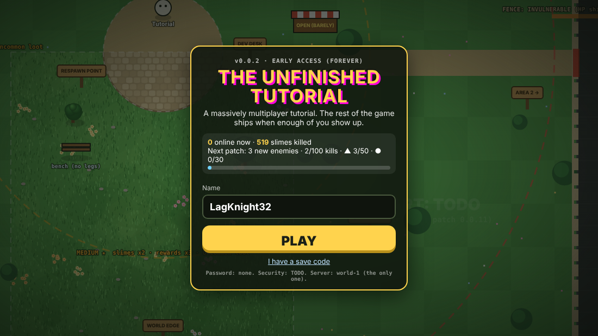

<picture>
  <source media="(max-width: 600px)" srcset="assets/header-phone.svg">
  
</picture>

I'm a solo dev<sup>[\*](https://github.com/connabyss/connabyss/blob/main/README.md?plain=1)</sup>. I make strange games, and [Bite](https://github.com/connabyss/bite), a tool that checks if a "fixed" bug is really fixed.

Bite's best catch so far: a [memory leak in prosemirror-py](https://github.com/fellowapp/prosemirror-py/pull/336) that a commit said was fixed. It wasn't. Now it is. I've had fixes and tests merged into [13 other people's projects](CONTRIBUTIONS.md).

<!--
*1 he says "I". the build log says otherwise.
   word 1 of 12: he
   next: he never reads response headers. i live in them.
         curl -I https://above-your-pay-grade.connabyss.workers.dev
-->

<details>
<summary><b>You found a strange profile. There's a door. Open it?</b></summary>
<br>

Inside is a small room: a desk, a computer that's humming a little too loud, and a black cat watching you.

<blockquote>
<details>
<summary><b>Sit at the computer</b></summary>
<br>

The screen is already on. Someone's files are moving on their own. One of them just renamed itself to `i_was_here_first.docx`.

The games are [right below this](#play-something-strange). Pick one.

</details>

<details>
<summary><b>Follow the cat</b></summary>
<br>

The cat walks you to a workbench covered in fixes that claim they work. Every fix here gets tested the same way: put the bug back and see if anything notices. That's [Bite](https://github.com/connabyss/bite).

The cat drops a few [small jobs](https://github.com/connabyss/bite/issues?q=is%3Aissue+is%3Aopen+label%3A%22good+first+issue%22) at your feet. Any of them is a good first pull request.

Or just come say hi in [Discussions](https://github.com/connabyss/bite/discussions).

</details>

<details>
<summary><b>Leave</b></summary>
<br>

You turn around. The door is gone. The wall is warm.

<details>
<summary><b>Knock on the wall</b></summary>
<br>

Something knocks back. A gap opens onto a game I haven't finished. Nobody has. [Go in anyway.](https://unfinished-tutorial.connabyss.workers.dev)

</details>
</details>
</blockquote>
</details>

## Play something strange

Click any picture to play it in your browser.

[](https://claude.ai/artifact/9F1638bwzjDckfcpDHseXe)

**Unknown Process**: my entry for the "Ghost in the Machine" game jam. You're the ghost in someone's computer: make their files creepy, let them in, and watch one scare set off the next.

<a href="https://unfinished-tutorial.connabyss.workers.dev"></a>

**The Unfinished Tutorial**: a tiny real MMO. Everyone is stuck in the starting area because the rest of the game never shipped. Fight slimes together.

<a href="https://above-your-pay-grade.connabyss.workers.dev"></a>

**Above Your Pay Grade**: trick an HR bot into leaking the CEO's salary. It falls for every trick. It still can't leak it.

[](https://connabyss.github.io/cold-case)

**Cold Case Unit**: type a GitHub username and get a crime file on every project its owner walked away from.

<a href="https://connabyss.github.io/excuse-court/"></a>

**Excuse Court**: type your excuse and Judge June Burden decides if you walk.

## Bite


AI coding agents love to say "fixed, and I added a test." Bite takes each fix back out of a copy of your project and runs your tests. If they still pass, nothing was checking the fix. Free, no key.

```
python -m pip install bite-check
python -m bite_check --free
```

[Try it](https://github.com/connabyss/bite#try-it-now) · [Discussions](https://github.com/connabyss/bite/discussions) · [Good first issues](https://github.com/connabyss/bite/issues?q=is%3Aissue+is%3Aopen+label%3A%22good+first+issue%22) · [Contribute](https://github.com/connabyss/bite/blob/main/CONTRIBUTING.md)

<br clear="left">

## Merged upstream

- [prosemirror-py](https://github.com/fellowapp/prosemirror-py/pull/336): the memory leak above
- [Tencent teamai-cli](https://github.com/Tencent/teamai-cli/pull/1669): secrets leaking through tool arguments
- [west](https://github.com/zephyrproject-rtos/west/pull/1013): crash on a reserved project name
- [h2](https://github.com/python-hyper/h2/pull/1343): a test for duplicate Host headers the check missed

[All 13 projects](CONTRIBUTIONS.md)

<p align="right"></p>
