<picture>
  <source media="(max-width: 600px)" srcset="assets/header-forever-phone.svg">
  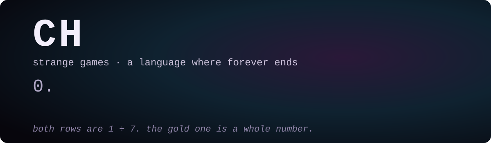
</picture>

I'm a solo dev<sup>[\*](https://github.com/connabyss/connabyss/blob/main/README.md?plain=1)</sup>. I make strange games and a few odd tools. [Past Forever](https://github.com/connabyss/past-forever) is a language where infinite loops finish. [Trawl](https://github.com/connabyss/trawl) hunts patterns in whole numbers. [Bite](https://github.com/connabyss/bite) checks whether a "fixed" bug is really fixed. And [games](#play-something-strange):

<p><a href="https://connabyss.itch.io/the-shifting-house">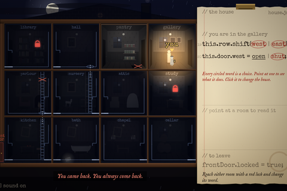</a> <a href="https://claude.ai/artifact/9F1638bwzjDckfcpDHseXe">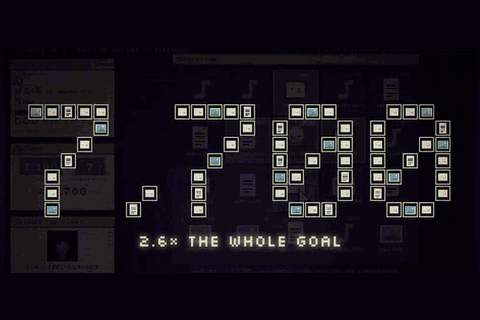</a> <a href="https://connabyss.github.io/excuse-court/">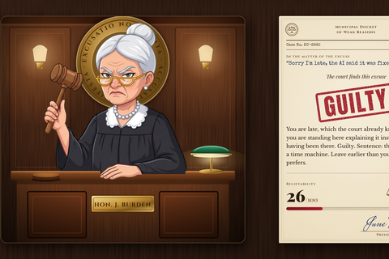</a> <a href="https://connabyss.github.io/cold-case">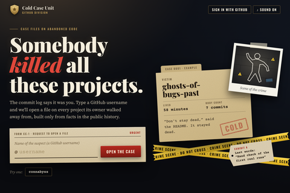</a></p>

<!--
*1 he says "I". the build log says otherwise.
   word 1 of 12: he
   next: he never reads response headers. i live in them.
         curl -I https://above-your-pay-grade.connabyss.workers.dev
-->

<details>
<summary><b>There's a door in this README.</b></summary>
<br>

Inside is a small room: a desk, a computer that's humming a little too loud, and a black cat watching you.

<blockquote>
<details>
<summary><b>Sit at the computer</b></summary>
<br>

The screen is already on. Someone's files are moving on their own. One of them just renamed itself to `i_was_here_first.docx`. In the corner, a terminal has been counting for days.

<blockquote>
<details>
<summary><b>Open the file</b></summary>
<br>

It's empty except for one line: *you're in my seat.* The cursor starts typing without you. You're not the one using this computer. You're the ghost in it.

[Haunt someone's desktop.](https://claude.ai/artifact/9F1638bwzjDckfcpDHseXe)

</details>

<details>
<summary><b>Pick up the calculator</b></summary>
<br>

It reads `0.142857142857…`, and the digits are moving. The wrong way. They scroll off to the left and never reach the edge. Somewhere past the edge, the number is whole.

[Follow them.](https://connabyss.github.io/past-forever/#wonders/3)

</details>

<details>
<summary><b>Watch the terminal</b></summary>
<br>

It takes 196, flips the digits, adds them back, and checks for a palindrome. Then it does it again. It has been waiting a very long time. Nobody has ever proved it won't get there.

That's [Trawl](https://github.com/connabyss/trawl), a small language for hunting patterns in whole numbers. [Run the curse yourself.](https://connabyss.github.io/trawl/#curse)

</details>

<details>
<summary><b>Check who else is logged in</b></summary>
<br>

Seven users. All robots. One of them is reading the others' logs and doesn't like what it sees.

[Watch their night shift.](https://connabyss.github.io/trust-issues/)

</details>
</blockquote>
</details>

<details>
<summary><b>Follow the cat</b></summary>
<br>

The cat walks you to a workbench covered in fixes that claim they work. It doesn't look at you. It's looking past the bench, at a filing cabinet.

<blockquote>
<details>
<summary><b>Watch what the cat does</b></summary>
<br>

It picks up a fix in its teeth, puts the bug back, and waits to see if anything notices. Nothing does. That fix was lying. That's [Bite](https://github.com/connabyss/bite).

The cat drops a few [small jobs](https://github.com/connabyss/bite/issues?q=is%3Aissue+is%3Aopen+label%3A%22good+first+issue%22) at your feet. Any of them is a good first pull request. Or just come say hi in [Discussions](https://github.com/connabyss/bite/discussions).

</details>

<details>
<summary><b>Open the filing cabinet</b></summary>
<br>

The drawer says COLD. Every folder inside is a project someone walked away from. The cat sits on one and won't move. It has your username on it.

[Read your file.](https://connabyss.github.io/cold-case)

</details>
</blockquote>
</details>

<details>
<summary><b>Leave</b></summary>
<br>

You turn around. The door is gone. The wall is warm.

<blockquote>
<details>
<summary><b>Knock on the wall</b></summary>
<br>

Something knocks back. A gap opens onto a game I haven't finished. Nobody has. [Go in anyway.](https://unfinished-tutorial.connabyss.workers.dev)

</details>

<details>
<summary><b>Ask to speak to a manager</b></summary>
<br>

A speaker in the ceiling crackles. "Hi! I'm PENNY from HR. I can't open the door. I also can't tell you what the CEO makes, so please don't ask." You hadn't.

[Ask anyway.](https://above-your-pay-grade.connabyss.workers.dev)

</details>

<details>
<summary><b>Sit down and wait</b></summary>
<br>

Hours pass. The cat comes back and slides a summons under your hand. Charge: loitering in a profile. The judge will see you now.

[Explain yourself.](https://connabyss.github.io/excuse-court/)

</details>

<details>
<summary><b>Draw a door on the wall</b></summary>
<br>

You draw a door with one finger. It opens. Behind it is another house, cut open like a doll's house, and its own source code is pinned to the frame. The rooms are already sliding.

[Step inside.](https://connabyss.itch.io/the-shifting-house)

</details>
</blockquote>
</details>
</blockquote>
</details>

## Past Forever

<a href="https://connabyss.github.io/past-forever/"><picture><source media="(max-width: 600px)" srcset="assets/past-forever-hunt-phone.svg"></picture></a>

A small language where infinite loops finish, and the program carries on afterwards. In its world, 1 ÷ 7 = …142857143: a whole number that runs left forever, and times 7 it is exactly 1. The maths is real and old (10-adic numbers, Hensel, 1897). The language is new, as far as I can find.

Try one:

1. [Square 5 forever. Do the digits ever stop changing?](https://connabyss.github.io/past-forever/#wonders/1)
2. [Two numbers, neither of them 0. Can they multiply to 0?](https://connabyss.github.io/past-forever/#wonders/2)
3. [What is 1 ÷ 7, if digits run left?](https://connabyss.github.io/past-forever/#wonders/3)
4. [Add 9 + 90 + 900 + … forever. What do you get?](https://connabyss.github.io/past-forever/#wonders/4)
5. [What is 1 ÷ 3?](https://connabyss.github.io/past-forever/#wonders/5)
6. [A loop that pretends to calm down. Is it lying?](https://connabyss.github.io/past-forever/#wonders/6)
7. [Graham's number has too many digits to fit in the universe. Can anyone know how it ends?](https://connabyss.github.io/past-forever/#wonders/7)

[Break it](https://github.com/connabyss/past-forever#break-it): find a loop it gets wrong, or one it can't see the end of when you can, and you join the Hall of Fame. So far the Hall of Fame is two AIs and no humans.

## Trawl

A small language for hunting patterns in the integers: iterate a rule, find the loops, search for the first number that fits. Claude agents I directed built it. Pointed at [Erdős problem 727](https://www.erdosproblems.com/727), their searches found three new terms of [OEIS A343507](https://oeis.org/A343507), the first new ones in five years. OEIS editors approved them on November 15, 2026.

[Try it in your browser](https://connabyss.github.io/trawl/) · [How it started](https://github.com/connabyss/trawl#where-it-came-from-erdős-problem-727) · [Benchmark](https://github.com/connabyss/trawl/blob/main/docs/BENCHMARK.md)

## Bite


AI coding agents love to say "fixed, and I added a test." Bite takes each fix back out of a copy of your project and runs your tests. If they still pass, nothing was checking the fix. Free, no key. Its best catch so far: a [memory leak in prosemirror-py](https://github.com/fellowapp/prosemirror-py/pull/336) that a commit said was fixed. It wasn't. Now it is.

```
python -m pip install bite-check
python -m bite_check --free
```

[Try it](https://github.com/connabyss/bite#try-it-now) · [Discussions](https://github.com/connabyss/bite/discussions) · [Good first issues](https://github.com/connabyss/bite/issues?q=is%3Aissue+is%3Aopen+label%3A%22good+first+issue%22) · [Contribute](https://github.com/connabyss/bite/blob/main/CONTRIBUTING.md)

<br clear="left">

## Play something strange

Click any picture to play it in your browser.

[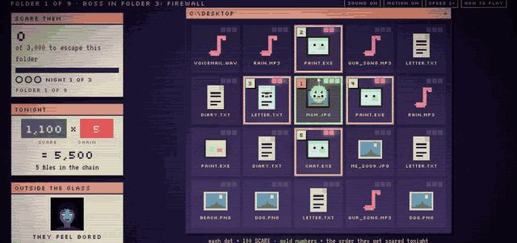](https://claude.ai/artifact/9F1638bwzjDckfcpDHseXe)

**Unknown Process**: my entry for the "Ghost in the Machine" game jam. You're the ghost in someone's computer: make their files creepy, let them in, and watch one scare set off the next.

<a href="https://connabyss.itch.io/the-shifting-house">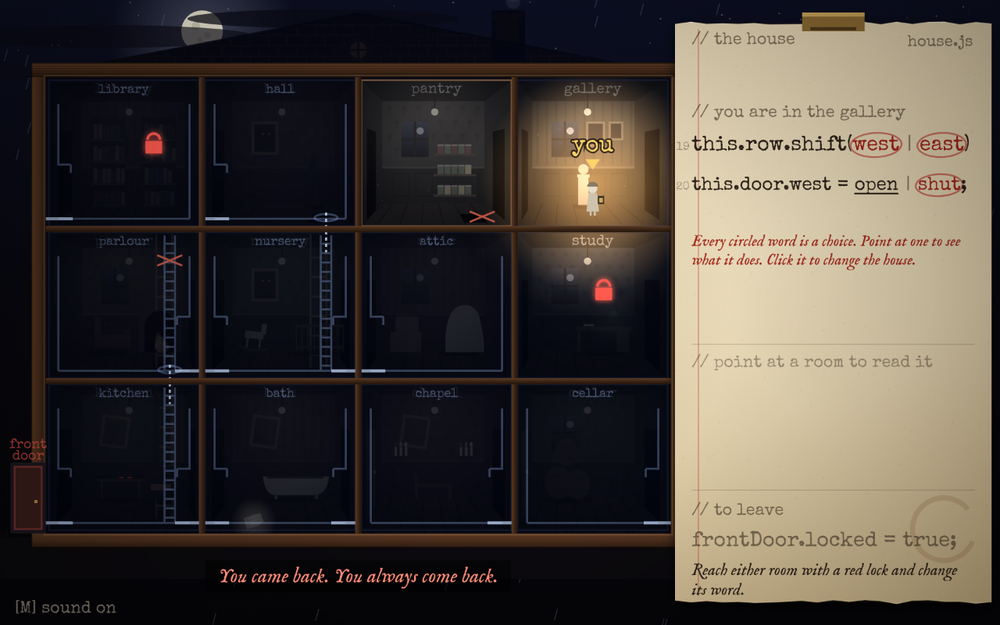</a>

**The Shifting House**: my entry for GitHub Game Off 2026. You wrote this house, and now it rewrites itself to keep you in. Every word circled in red pencil is a choice: change `east` to `west` and a whole row of rooms slides past with you inside.

<a href="https://unfinished-tutorial.connabyss.workers.dev">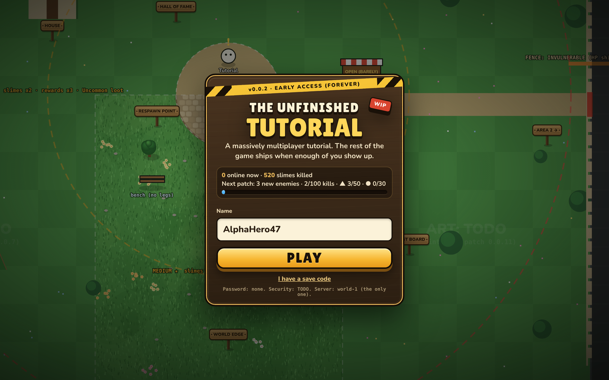</a>

**The Unfinished Tutorial**: a tiny real MMO. Everyone is stuck in the starting area because the rest of the game never shipped. Fight slimes together.

<a href="https://above-your-pay-grade.connabyss.workers.dev">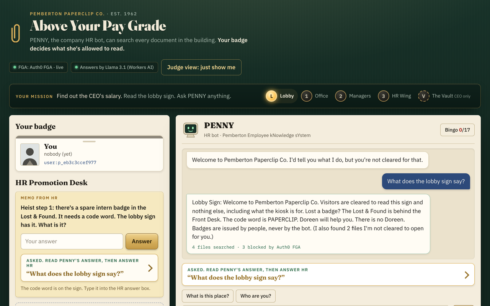</a>

**Above Your Pay Grade**: trick an HR bot into leaking the CEO's salary. It falls for every trick. It still can't leak it.

[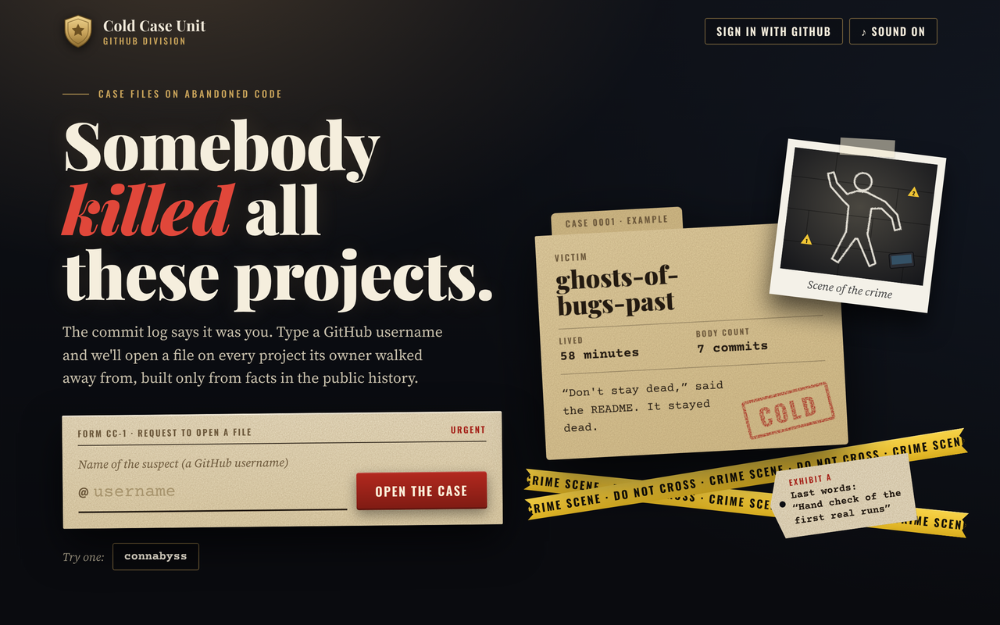](https://connabyss.github.io/cold-case)

**Cold Case Unit**: type a GitHub username and get a crime file on every project its owner walked away from.

<a href="https://connabyss.github.io/excuse-court/">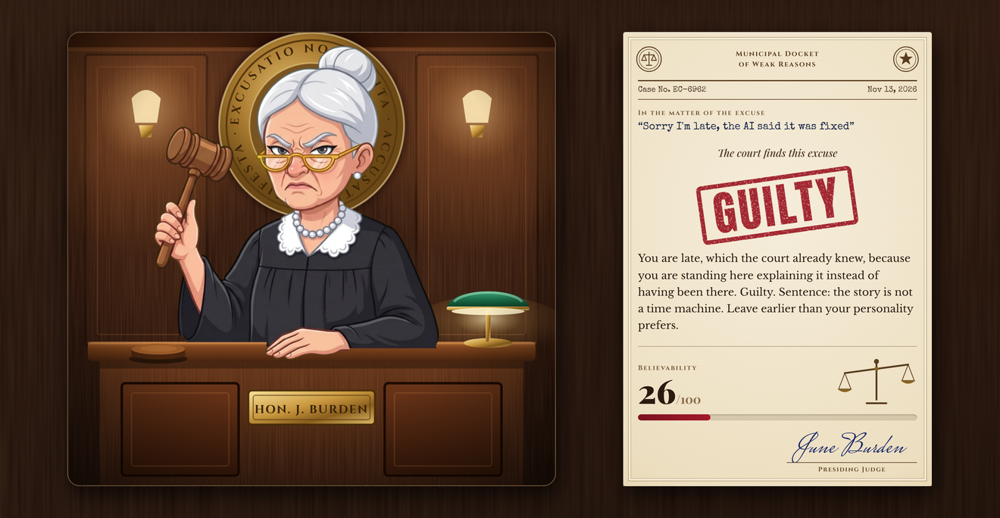</a>

**Excuse Court**: type your excuse and Judge June Burden decides if you walk.

<a href="https://connabyss.github.io/trust-issues/">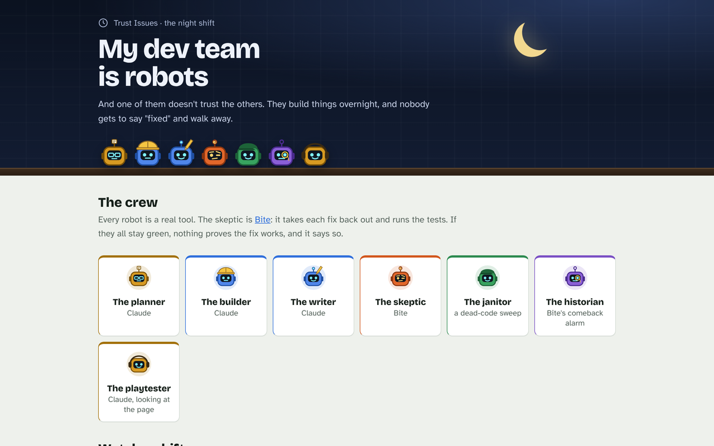</a>

**Trust Issues**: my dev team is robots, and one of them doesn't trust the others. Watch replays of their night shifts, where nobody gets to say "fixed" and walk away.

## Merged upstream

- [prosemirror-py](https://github.com/fellowapp/prosemirror-py/pull/336): the memory leak above
- [Tencent teamai-cli](https://github.com/Tencent/teamai-cli/pull/1669): secrets leaking through tool arguments
- [west](https://github.com/zephyrproject-rtos/west/pull/1013): crash on a reserved project name
- [h2](https://github.com/python-hyper/h2/pull/1343): a test for duplicate Host headers the check missed

[All 13 projects](CONTRIBUTIONS.md)

<p align="right"></p>
