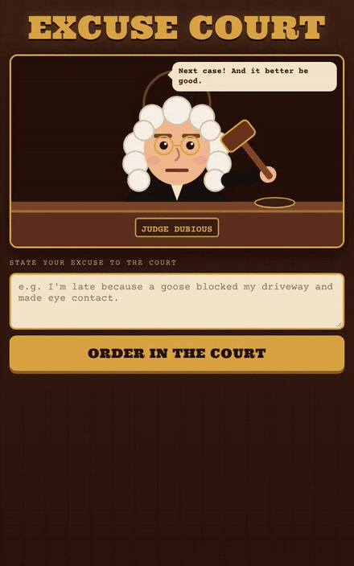
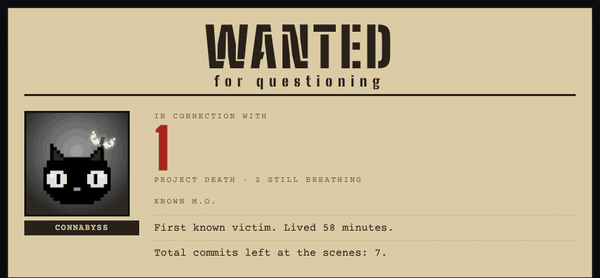

## CH

I make strange games and I hunt bugs. About half and half.

**Games.** Absurd, a little creepy, played straight. Right now I'm making *Unknown Process*, a game jam roguelike where you're a ghost haunting someone's files. Also finishing a small online game I started for fun. The games I keep going back to: Balatro, RimWorld, RuneScape, Disco Elysium.

**Bugs.** My favorite bug is a fix that didn't fix anything. So I built [Bite](https://github.com/connabyss/bite): it takes the fix back out and runs your tests. If they still pass, nothing was checking the fix. `pipx install bite-check`

A few fixes that got merged upstream:

- **prosemirror-py**: a memory leak a commit said was fixed but wasn't ([#336](https://github.com/fellowapp/prosemirror-py/pull/336))
- **Tencent teamai-cli**: secrets leaking through tool arguments ([#1669](https://github.com/Tencent/teamai-cli/pull/1669), [#1671](https://github.com/Tencent/teamai-cli/pull/1671))
- **west** (Zephyr's command-line tool): crash on a reserved project name ([#1013](https://github.com/zephyrproject-rtos/west/pull/1013))
- **h2** (Python's HTTP/2 library): test for duplicate Host headers the check missed ([#1343](https://github.com/python-hyper/h2/pull/1343))

[All contributions](CONTRIBUTIONS.md) · [Writing](https://dev.to/connabyss)

### Play something strange

Click any clip to play it in your browser.

**Unknown Process**: my entry for the "Ghost in the Machine" game jam. You're the ghost in someone's computer: make their files creepy, let them in, and watch one scare set off the next.

**Above Your Pay Grade**: trick an HR bot into leaking the CEO's salary. It falls for every trick. It still can't leak it.

**Excuse Court**: type your excuse and Judge Dubious decides if you walk.

**Cold Case Unit**: type a GitHub username and get a crime file on every project its owner walked away from.
